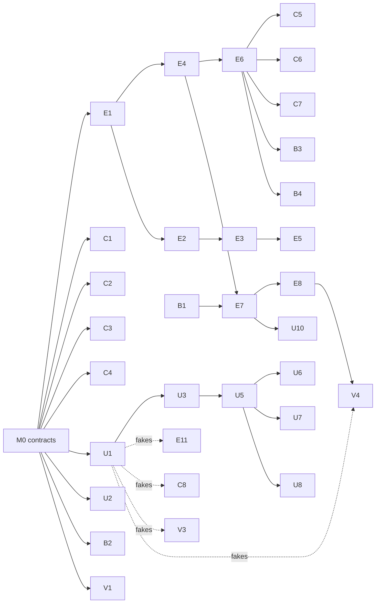

# King of Xitter: Roadmap

A single-player Android game that plays by the **King of Tokyo** rules (original base game, 66 cards). You play against 3 bots. The theme is the parody design in [`design/`](design/). All 6 leaders can be played.

- **Team:** 4 developers, one track each: A Engine @Samylay, B Power-ups @AzerX2, C In-game UI @Seleis36, D Bots & voice @khvatovat. Personal guides are in [`docs/team/`](docs/team/). Each track owns its own modules, so people rarely wait on each other.
- **Stack:** Kotlin, Jetpack Compose, multi-module Gradle, min SDK 26, target SDK 35. It runs fully offline. There's no backend and no LLM; tweets come from templates.
- **Estimates** are in points. 1 pt ≈ half a day of focused work. Each track totals about 40 pts, so roughly 5–6 weeks at part-time pace.

---

## 1. Rules mapping (King of Tokyo → Xitter)

The rules stay exactly the same as King of Tokyo. Only the names change.

| King of Tokyo | King of Xitter | Notes |
|---|---|---|
| Monster | Leader | 6 leaders. You pick 1, and 3 bots are drawn from the other 5 |
| Health (10, max 10) | Followers (10M) | 0 = **suspended** (eliminated) |
| Victory points (win at 20) | Mandates (win at 20) | Certification badge: 0–5 none, 6–14 blue, 15+ gold (cosmetic only) |
| Energy cube | Characters, **×10** | 1 energy = 10 chars. All card costs ×10 |
| Tokyo City | Xitter / Main Character | With 4 players there is only one spot, so no Tokyo Bay |
| Claw | Tweet | 1 unfollow each |
| Heart | Like | +1M, capped at max. You get no likes while Main Character |
| Energy face | Characters face | +10 chars each |
| 1 / 2 / 3 | 1 / 2 / 3 | Three of a kind scores its face value, and each extra die adds +1 |
| Yield Tokyo | Log off | The attacker takes your spot |
| Card shop (3 face up, sweep for 2) | Power-up shop (sweep for 20 chars) | Keep = **Policy**, Discard = **Executive Order** |

**Turn order:** roll 6 dice, then up to 2 rerolls (3 rolls total), then resolve (numbers → likes → chars → tweets), then enter Xitter if it's empty, then buy power-ups, then end-of-turn effects.

**Xitter rules:**
- Enter an empty Xitter: +1 mandate.
- Start your turn on Xitter: +2 mandates.
- The Main Character's tweets hit everyone else. Everyone else's tweets hit only the Main Character.
- When hit, the Main Character may log off, and the attacker must take the spot.
- If the attacker is eliminated at the same moment, nobody takes the spot.

**Win:** reach 20 mandates, or be the last account standing. If everyone is eliminated at once, nobody wins.

**First player:** roll-off. Most tweets goes first. This is shown on the Versus intro screen.

### Open design decisions (owner: @Samylay, decide in M0)

1. **Char cap of 280.** The design banks at most 280 chars, but King of Tokyo has no energy cap. *Recommendation:* keep the cap as a toggle. Default it to off to match the "exactly like King of Tokyo" goal, and show the ring as full above 280.
2. **Bot Farm cost.** The design shows 50, but Even Bigger costs 4 (→ 40). *Recommendation:* use 40 and update the design.
3. **Leader abilities.** Base King of Tokyo monsters have no abilities, so leaders differ only in portrait, colour, tweet voice and bot personality. Abilities (for example the King of Tokyo *Power Up!* evolutions) would be a post-v1 add-on.

---

## 2. Power-up catalogue (all 66 base cards)

The effects are the King of Tokyo originals. Energy costs are ×10 and damage/health are in millions. The names are proposals (@AzerX2 owns them), and anything marked ★ comes from the design. **K** = Policy (keep), **D** = Executive Order (discard). The *Cx* column is the task that implements the card (see §5).

| # | King of Tokyo card | Xitter name | Cost | Type | Effect | Cx |
|---|---|---|---|---|---|---|
| 1 | Acid Attack | Doomscroll Drip | 60 | K | Deal 1 extra unfollow each turn, even if you roll no tweets | C4 |
| 2 | Alien Metabolism | Lobbyist | 30 | K | Power-ups cost 10 fewer chars | C4 |
| 3 | Alpha Monster | Alpha Poster | 50 | K | +1 mandate when you tweet at someone | C4 |
| 4 | Armor Plating | Thick Skin PR ★ | 40 | K | Ignore hits of exactly 1 | C4 |
| 5 | Background Dweller | Lurker | 40 | K | You may always reroll any 3s | C5 |
| 6 | Burrowing | Home Turf | 50 | K | +1 unfollow while on Xitter. When you log off, the new Main Character loses 1M | C4 |
| 7 | Camouflage | Parody Account | 30 | K | When hit, roll 1 die per hit; each like cancels one | C7 |
| 8 | Complete Destruction | Full Bingo | 30 | K | Rolling 1-2-3-like-tweet-chars: +9 mandates | C4 |
| 9 | Dedicated News Team | Press Office ★ | 30 | K | +1 mandate per power-up bought | C4 |
| 10 | Eater of the Dead | Gravedancer | 40 | K | +3 mandates whenever a leader is suspended | C4 |
| 11 | Energy Hoarder | Drafts Folder | 30 | K | At end of turn, +1 mandate per 60 chars you hold | C4 |
| 12 | Even Bigger | Bot Farm ★ | 40 | K | +2M max followers; gain 2M now | C4 |
| 13–14 | Extra Head ×2 | Second Phone | 70 | K | +1 die | C4 |
| 15 | Fire Breathing | Quote Tweet | 40 | K | Your neighbours lose 1M extra when you deal damage | C4 |
| 16 | Freeze Time | Pinned Tweet | 50 | K | On 1-1-1, take another turn with one fewer die | C6 |
| 17 | Friend of Children | Influencer Deal | 30 | K | +10 extra chars whenever you gain chars | C4 |
| 18 | Giant Brain | Speechwriter ★ | 50 | K | +1 reroll each turn | C4 |
| 19 | Gourmet | Old Guard | 40 | K | 1-1-1 scores +2 extra | C4 |
| 20 | Healing Ray | Retweet for Retweet | 40 | K | Your likes can heal others; they pay you 20 chars per 1M | C7 |
| 21 | Herbivore | Peace Summit | 50 | K | +1 mandate on a turn where you hit nobody | C4 |
| 22 | Herd Culler | Poll Rigger | 30 | K | Once per turn, change one die to a 1 | C5 |
| 23 | It Has a Child | Burner Account | 70 | K | When suspended: discard all cards, lose all mandates, return with 10M followers | C7 |
| 24 | Jets | Private Jet | 50 | K | You lose no followers when you log off | C4 |
| 25 | Made in a Lab | Leaked Memo | 20 | K | Peek at and buy the top card of the deck | C7 |
| 26 | Metamorph | Pivot | 30 | K | At end of turn, discard policies for their full cost in chars | C7 |
| 27 | Mimic | Copycat Policy | 80 | K | Copy another leader's policy; 10 chars at turn start to switch | C7 |
| 28 | Monster Batteries | Super PAC | 20 | K | Load 60 chars; take 20 at the start of each turn; discard when empty | C6 |
| 29 | Nova Breath | Going Viral | 70 | K | Your tweets hit everyone | C4 |
| 30 | Omnivore | Big Tent | 40 | K | Once per turn, 1-2-3 scores 2 (those dice still count for other sets) | C4 |
| 31 | Opportunist | Breaking News Alerts | 30 | K | You may buy newly revealed cards immediately | C7 |
| 32 | Parasitic Tentacles | Hostile Takeover | 40 | K | Buy other leaders' policies by paying them | C7 |
| 33 | Plot Twist | October Surprise | 30 | K | Change one die to any face, then discard | C5 |
| 34 | Poison Quills | Fact Check | 30 | K | 2-2-2 also deals 2 unfollows | C4 |
| 35 | Poison Spit | Cancel Campaign | 40 | K | Give *cancelled* counters when you deal damage; −1M per counter at end of their turn; a like removes one | C6 |
| 36 | Psychic Probe | Phone Tap | 30 | K | Reroll one of another leader's dice once per turn; discard if it becomes a like | C5 |
| 37 | Rapid Healing | Paid Promotion | 30 | K | Pay 20 chars at any time: +1M | C5 |
| 38 | Regeneration | Comeback Tour | 40 | K | Heal 1M extra whenever you heal | C4 |
| 39 | Rooting for the Underdog | Underdog Narrative | 30 | K | At end of turn, if you have the fewest mandates: +1 | C4 |
| 40 | Shrink Ray | Shadowban | 60 | K | Give *shadowban* counters when you deal damage; −1 die per counter; a like removes one | C6 |
| 41 | Smoke Cloud | Smoke and Mirrors | 40 | K | 3 counters; spend 1 for an extra reroll; discard when empty | C6 |
| 42 | Solar Powered | Ghostwriter | 20 | K | At end of turn with 0 chars, gain 10 | C4 |
| 43 | Spiked Tail | CAPS LOCK STUCK ★ | 50 | K | +1 unfollow when you tweet | C4 |
| 44 | Stretchy | Spin Doctor | 30 | K | Pay 20 chars: change one die to any face | C5 |
| 45 | Telepath | Focus Group | 40 | K | Pay 10 chars: +1 reroll | C5 |
| 46 | Urbavore | Main Character Energy | 40 | K | +1 mandate when starting on Xitter; +1 unfollow while on Xitter | C4 |
| 47 | We're Only Making It Stronger | Martyr Complex | 30 | K | Lose 2M+ at once: +10 chars | C4 |
| 48 | Wings | Touch Grass | 60 | K | Pay 20 chars: negate all hits to you this turn | C5 |
| 49 | Apartment Building | Op-Ed | 50 | D | +3 mandates | C3 |
| 50 | Commuter Train | Photo Op | 40 | D | +2 mandates | C3 |
| 51 | Corner Store | Baby Kissing | 30 | D | +1 mandate | C3 |
| 52 | Death From Above | Hijack the Trend | 50 | D | +2 mandates and take Xitter | C3 |
| 53 | Energize | Content Binge | 80 | D | +90 chars | C3 |
| 54–55 | Evacuation Orders ×2 | Leaked Group Chat ★ | 70 | D | Every other leader loses 5 mandates | C3 |
| 56 | Fire Blast | Subtweet Storm | 30 | D | 2 unfollows to every other leader | C3 |
| 57 | Frenzy | All-Nighter | 70 | D | Take another turn after this one | C6 |
| 58 | Gas Refinery | State Media Blitz | 60 | D | +2 mandates; 3 unfollows to every other leader | C3 |
| 59 | Heal | Buy Followers ★ | 30 | D | +2M followers (works while on Xitter) | C3 |
| 60 | High Altitude Bombing | Reply-All Disaster | 40 | D | Every leader, you included, loses 3M | C3 |
| 61 | Jet Fighters | Military Parade | 50 | D | +5 mandates; you lose 4M | C3 |
| 62 | National Guard | Press Conference | 30 | D | +2 mandates; you lose 2M | C3 |
| 63 | Nuclear Power Plant | Rally | 60 | D | +2 mandates; +3M | C3 |
| 64 | Skyscraper | Golden Tower | 60 | D | +4 mandates | C3 |
| 65 | Tanks | Hot Mic | 40 | D | +4 mandates; you lose 3M | C3 |
| 66 | Vast Storm | Market Crash | 60 | D | +2 mandates; others lose 10 chars per 20 held | C3 |

---

## 3. Architecture (the key to parallel work)

```
:engine   pure Kotlin/JVM. GameState, Action, Event, Decision, rules reducer, seeded RNG, CardHooks API   ← @Samylay
:cards    pure Kotlin. CardCatalog + one CardEffect per card, deck/shop logic                             ← @AzerX2
:bots     pure Kotlin. BotBrain implementations (Intern / Reply Guy / Troll Farm)                         ← @khvatovat
:content  pure Kotlin. Leader roster, TweetWriter (6 voices × event types), zingers, trending tags        ← @khvatovat
:app      Android. Compose design system, screens, navigation, GameViewModel, persistence, audio         ← @Seleis36 (+ A, B, D for their own screens)
```

`:app` depends on everything. `:cards`, `:bots` and `:content` depend only on `:engine` (the API) and never on each other.

**How the engine works.** It's a pure reducer: `(GameState, Action) -> (GameState, List<Event>)`. It never waits for input. It stops at a `PendingDecision` (keep dice? stay or log off? buy? use a card?). A human answers through the UI and a bot answers through `BotBrain`. Because of this, the same engine drives the UI, the bots, unit tests and headless simulations.

**Contracts frozen in M0** (after that, changes go through a PR reviewed by the affected owners):

| Contract | Owner | Consumers |
|---|---|---|
| `GameState`, `PlayerState`, `DiceFace`, `Action`, `Event`, `PendingDecision` | A | B, C, D |
| `CardEffect` hooks (`onBuy`, `diceCount`, `rerollCount`, `onResolve`, `modifyOutgoingDamage`, `modifyIncomingDamage`, `onTurnStart/End`, `onEliminated`, `activatedAbilities`) + `CardDef` | B (A reviews) | A |
| `GameController` (`state: StateFlow`, `events: Flow`, `submit(Action)`) + `FakeGameController` | A | C, D |
| `BotBrain.decide(state, decision, rng): Action` | D | A, C |
| `TweetWriter.write(event, leaderId, rng): Tweet` + `Leader` roster | D | C |
| Design tokens (`XColors`, `XType`, `Modifier.sticker()`), shared components | C | A, B, D |
| `GameFixtures`: one `GameState` per design screen | A + C | everyone (previews and tests) |

**Rules that keep people unblocked:**
1. **Code against fakes.** UI screens are built on `FakeGameController` and `GameFixtures` in Compose previews, so they never wait for the engine. Cards are unit-tested with a `TestGame` state builder. Bots start with the random Intern bot, which needs only the `Decision` API.
2. **Cards are pluggable.** The engine ships with an empty deck plus 2 stub cards, and each card PR registers itself in `CardCatalog`. A card that isn't finished is simply left out of the deck.
3. **Each track owns its folders** (see `.github/CODEOWNERS`), so there are almost no merge conflicts.
4. **Trunk-based.** PRs stay small (under ~400 lines) and get merged daily behind `FeatureFlags` when needed. CI runs unit tests and a lint pass on every PR.
5. **Integration checkpoint** at the end of each milestone: a 30-minute play session on a device.

---

## 4. Milestones

| Milestone | Target | Exit criteria |
|---|---|---|
| **M0 Contracts** | Days 1–3 | Project builds in CI. All contracts from §3 are merged with KDoc. Fixtures render in previews. Design assets are imported |
| **M1 Walking skeleton** | Week 2 | A base-rules match (no power-ups) plays end to end in a JVM test with 4 Intern bots. The shop deck deals and Executive Orders work. Shared components, stats and dice render every fixture |
| **M2 Full rules, on device** | Week 4 | A full match on a phone from title to victory/defeat. Every screen from the design exists. All 6 leaders can be picked. All power-ups work except the 8 complex ones (C7). The Reply Guy bot works. The simulator runs |
| **M3 Content & polish** | Week 5 | All 66 power-ups, all tweet voices, Troll Farm, leader personalities, motion, audio/haptics, save/resume. 10k simulated games with no crash |
| **M4 Release** | Week 6 | QA pass, Play internal testing track, signed AAB |

| Week | @Samylay: Engine | @AzerX2: Power-ups | @Seleis36: In-game UI | @khvatovat: Bots + voice |
|---|---|---|---|---|
| 1 | M0 → E1, E4 | M0 → C1, C2 | M0 → U1, U2 | M0 → B1, V1 |
| 2 | E2, E3, E5, E7 | C3, C4 | U3, U4, U5 | V1, V5, B2 |
| 3 | **E6**, E8, E12 | C4, C8, C5 | U5, U6, U7 | B2, V2, V4 |
| 4 | E10, E11 | C5, C6, C9 | U10 | V4, B4, V3 |
| 5 | E9, fixes found by the sim | C7, balance | U8, U9 | B3, V6 |
| 6 | QA + release | QA | QA | QA |

---

## 5. Work breakdown

Dependencies marked `M0` mean only the frozen contracts. Nothing outside M0 blocks a whole track. Cross-track dependencies are listed explicitly, and each one has a fake to use in the meantime.

### M0: Contracts (all 4 in parallel, ~3 days)

| ID | Task | Owner | Pts |
|---|---|---|---|
| S1 | Gradle multi-module skeleton, version catalog, CI (build, test, ktlint), CODEOWNERS, PR template | A | 2 |
| S2 | `:engine` API: state/action/event/decision models and the `GameController` interface, with KDoc | A | 2 |
| S3 | `CardDef` + `CardEffect` hook interface; `TestGame` state builder | B | 2 |
| S4 | Compose theme: colours, 3 fonts (Luckiest Guy, Anton, Rubik; TTF from Google Fonts, OFL), `Modifier.sticker()`, app shell and nav graph with placeholder routes | C | 2 |
| S5 | `BotBrain` + `TweetWriter` interfaces; `Leader` roster (6 leaders: id, names, handle, colour, portrait); portraits converted to VectorDrawables | D | 2 |
| S6 | `GameFixtures` (one state per design screen) + `FakeGameController` | A + C | 1+1 |

### Track A: Engine and game flow (@Samylay) ≈ 40 pts

| ID | Task | Depends on | Pts |
|---|---|---|---|
| E1 | Seeded RNG, dice roll/keep/reroll, roll counter, extra-dice and extra-reroll hooks | M0 | 3 |
| E2 | Dice resolution: 1/2/3 sets, likes (blocked on Xitter, capped at max), chars, tweets | E1 | 3 |
| E3 | Xitter: enter when empty (+1), start-of-turn +2, damage routing (in vs. out), stay/log-off decision, attacker takes the spot | E2 | 5 |
| E4 | Turn state machine: phases, `PendingDecision` queue, end of turn, skipping suspended players | E1 | 4 |
| E5 | Elimination, simultaneous elimination, win at 20 / last standing / nobody wins | E3 | 2 |
| E6 | Hook dispatch at every hook point in `CardEffect` (card-order independent), extra turns, counters on `PlayerState` | E4, S3 | 5 |
| E7 | Real `GameController` / `GameViewModel`: coroutine loop, bot turns with pacing delays, human decisions from the UI | E4 · uses D's Intern bot (fake: always-first-option bot) | 4 |
| E8 | Match setup: pick leader, draw 3 random bots from the other 5, roll-off for first player | E7 | 2 |
| E9 | Save/resume: serialize `GameState` (kotlinx.serialization) and restore after process death | E7 | 3 |
| E10 | Match stats (tweets sent, unfollows dealt, turns as Main Character) for the end screens | E5 | 1 |
| E11 | Screens: Victory, Defeat (account suspended), Standings | U1–U3 (fakes until then) | 5 |
| E12 | Rules engine test suite: golden games from recorded seeds, and every rule in §1 covered by a test | E1–E6 | 3 |

### Track B: Power-ups (@AzerX2) ≈ 40 pts

| ID | Task | Depends on | Pts |
|---|---|---|---|
| C1 | `CardCatalog` data for all 66 cards: name, cost, type, rules text, flavour line | S3 | 3 |
| C2 | Deck/shop: shuffle, 3 face up, buy and refill, sweep for 20 chars, discard pile, handling an empty deck | S3 | 4 |
| C3 | All Executive Orders (#49–66) except All-Nighter | C2 | 4 |
| C4 | Passive policies (the C4 rows in §2, 26 cards) | S3 · hooks run for real after E6 | 8 |
| C5 | Die-manipulation and activated policies (Lurker, Poll Rigger, October Surprise, Phone Tap, Paid Promotion, Spin Doctor, Focus Group, Touch Grass): each adds `PendingDecision` / `ActivatedAbility` entries | E6 | 6 |
| C6 | Counters and turn manipulation: Cancel Campaign, Shadowban, Smoke and Mirrors, Super PAC, Pinned Tweet, All-Nighter | E6 | 4 |
| C7 | Complex cards: Copycat Policy, Burner Account, Hostile Takeover, Leaked Memo, Breaking News Alerts, Pivot, Retweet for Retweet, Parody Account | E6 | 6 |
| C8 | Card UI component (sticker card: cost bubble, POLICY/ORDER tag, text) + Power-up shop screen + policy tray on the board | U1–U3 (fakes until then) | 4 |
| C9 | Card-ability prompts: "use Spin Doctor?", pick a die or face, pick a target leader | U1, C5 | 1 |

### Track C: In-game UI (@Seleis36) ≈ 40 pts

| ID | Task | Depends on | Pts |
|---|---|---|---|
| U1 | Shared components: buttons (primary/secondary/ghost/disabled), chips, tags, stickers (SAD!, NYET., ¡AFUERA!, …), avatars | S4 | 4 |
| U2 | Icon set: extract the inline SVG icons (tweet, like, chars, followers, mandates, checks) from `design/screens/ui-kit.html` into VectorDrawables | S4 | 2 |
| U3 | Stat widgets: followers bar (10 pips), chars ring, mandate counter with certification badge, compact bot panel | U1, U2 | 4 |
| U4 | Die component: 54/36/28 px sizes, kept state (yellow, lifted, tilted), tumble animation | U2 | 4 |
| U5 | Game board screen: top bot panels, the Xitter stage with the Main Character's tweet, your panel, dice tray, "if you stop now" preview, reroll/resolve buttons | U3, U4 · FakeGameController | 7 |
| U6 | Compose attack tweet screen: target, damage preview, pick a zinger, send | U5 · zingers from D (fixture strings until then) | 3 |
| U7 | Incoming tweet screen: stay or log off | U5 | 3 |
| U8 | Motion: slam, shake, rise (damage numbers), pop, stamp (RATIO'D/SUSPENDED), wobble/bob idle loops; event-driven animation queue | U5 | 5 |
| U9 | Audio and haptics: dice, tweet, hit, win/lose; settings toggles | U8 | 3 |
| U10 | Wire the real `GameController` into the board; animate from `Event`s; accessibility (content descriptions, font scaling), small-phone layout | E7 | 5 |

### Track D: Bots, voices and the front door (@khvatovat) ≈ 40 pts

| ID | Task | Depends on | Pts |
|---|---|---|---|
| B1 | **Intern** bot: random legal actions (needed first, unblocks E7) | S5 | 1 |
| B2 | **Reply Guy** bot (design text: buys power-ups, rarely logs off, targets the weakest), using heuristics: keep-dice policy, stay/leave by health, card valuation | M0 · plays for real after E6 | 6 |
| B3 | **Troll Farm** bot: Monte Carlo lookahead with the engine as a simulator (clone state, sample rolls) | E6, B2 | 6 |
| B4 | Headless simulator CLI (`./gradlew :bots:sim`): N games, win rate per bot/leader, crash detection. Used to balance and to find engine bugs | E6 | 3 |
| V1 | `TweetWriter` voices for all 6 leaders × events (rolled, attacked, got hit, entered/left Xitter, bought, suspended, won, lost, burner tweet), at least 5 lines each, following the style guide in `design/screens/the-cast-and-their-tweet-voices.html` | S5 | 6 |
| V2 | Zingers for the compose screen (3+ per attacker × target pair), fake engagement numbers, trending hashtags | V1 | 3 |
| V3 | Match timeline screen with filters (For you / Beef only / My ratios) | U1, V1 | 3 |
| V4 | Title screen (marquee of trending tags), Pick your leader + bot difficulty, Versus intro with the animated roll-off | U1 (fakes until then), E8 | 6 |
| V5 | How to play + Settings (sound, haptics, animation speed, bot speed, rules toggles from §1) | U1 | 3 |
| V6 | Leader bot personalities: each leader tweaks the Reply Guy weights (Kim hoards mandates, Mi-León attacks everything, …) | B2 | 3 |

**Totals:** A 40 · B 40 · C 40 · D 40, plus shared M0 work (2 pts each).

---

## 6. Critical path and hand-offs



- **E6 (hook dispatch) is the main blocker.** @Samylay lands it at the start of week 3, right before C5–C7, B3 and B4 need it. Until then, @AzerX2 writes C1–C4 against `TestGame` (the hooks are pure functions) and @khvatovat writes B2 against fixtures. If E6 slips, @AzerX2 moves C8 earlier.
- **B1 (Intern bot)** is 1 pt and unblocks E7. @khvatovat does it on day 4.
- **U1–U3** unblock the screens owned by A, B and D. Until they land, those developers use raw Material components and swap them later.

---

## 7. Definition of done (every task)

- Unit tests for the logic. Engine and card tasks need a test per rule or card effect.
- Compose screens have a `@Preview` for each relevant fixture and are checked against the matching design screen.
- There are no strings in code. The theme's text goes in `strings.xml` so a French or Spanish translation can come later.
- The PR is reviewed by one other track, and CI is green.
