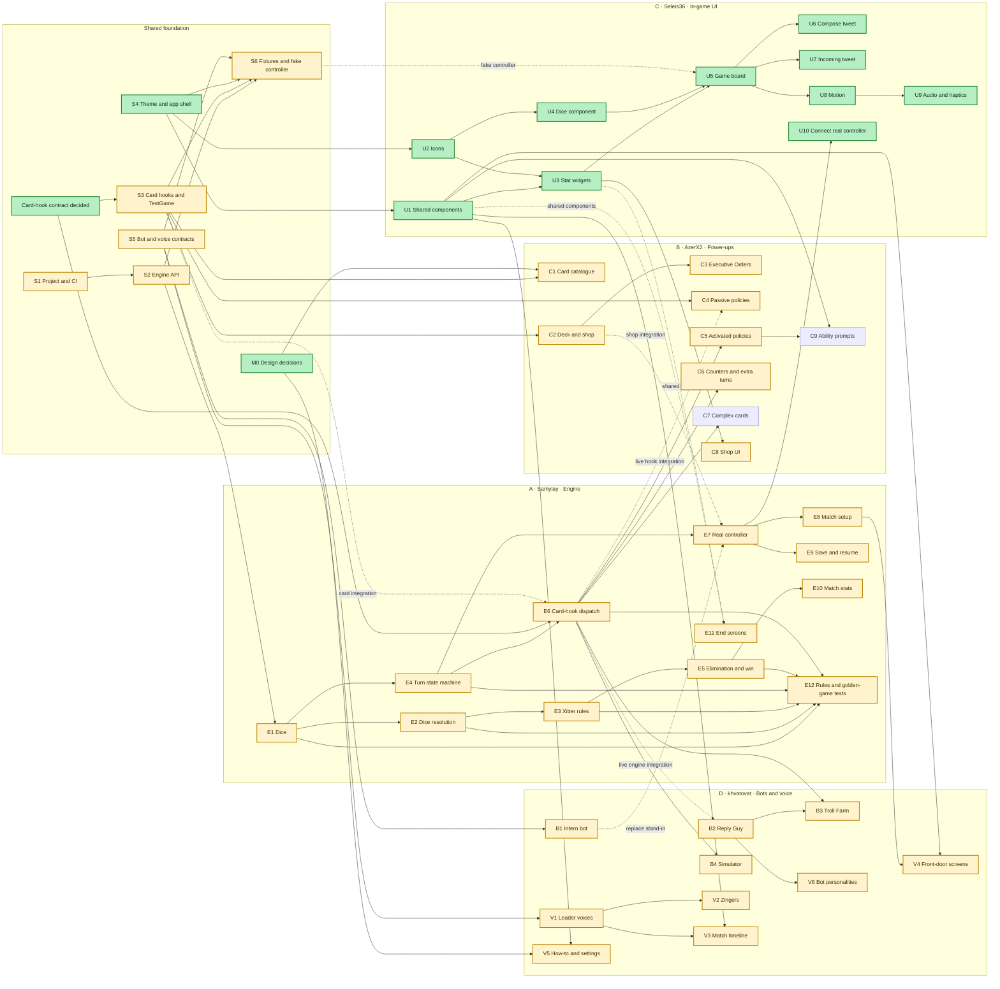

# Project dependency graph

This graph combines the task dependencies and cross-team hand-offs from
[`ROADMAP.md`](../ROADMAP.md) and [`docs/team/`](team/). Green means the task's
implementation is verified, committed, and pushed, including applicable
requirements in ROADMAP §7. Yellow means implementation or verification is in
progress or awaiting external review/integration. A task needs green CI and
a reviewer from another track before it becomes green; agent review alone does
not satisfy that requirement. Decision nodes record agreed decisions.

## Current hand-offs

Implementation and verification details: [Track A review and handoff](track-a-handoff.md).

- S1/S2, Samylay's S6 fixtures, and E1–E12 have implementations on
  `codex/engine-base-rules`. All independently executable Track A work is
  locally verified. Yellow records the remaining cross-track approvals and
  integrations, not missing controller/setup/save implementations.
- E7 uses `RealGameController` and the always-first-option stand-in. Public
  `Action.EndTurn` exits `SHOP`, so C2 never needs to block base matches.
  E8 supplies seeded leader selection and roll-off history. E9 stores state,
  RNG, queued choices, and human ownership atomically.
- E6 is implemented and merged on `main` in PR #48, closing issue #12. S3's
  registry/effects remain open for AzerX2 to integrate; B3/B4 can use the real
  hook APIs. Cross-track review of the engine contract additions remains
  outstanding, so E6 stays yellow under ROADMAP §7. Actual card effects, shop
  purchases, and bot strategies remain owned by B/D.
- E11 uses Material stand-ins and was checked on an API 27 emulator, including
  small-screen/large-text layouts. S4/U1–U3 supply the final theme/components;
  S5/V1 supply portraits and generated match text; S4/U10 wire navigation.
- S6 is shared: Samylay supplies states; Seleis36 checks them against the design.
- Samylay (Track A) reviewed and approved Seleis36's S4 and U1–U10 work on
  2026-09-28. PRs #49–#59 are merged, the combined local build/test/lint check
  passed (100 tests, 0 failures), and post-merge CI passed on `main` at
  `bf5914174d09591d24a3c1069d6e935766a03c5f`.
- S1/S2 were previously green without evidence of the required cross-track
  approval. They are yellow until ROADMAP §7 is satisfied. Keep all task nodes
  yellow until implementation, tests, device checks where relevant, remote CI,
  review, commit and push are verified. S4 and U1–U10 are green after the
  cross-track review and validation recorded above.
- M0 decisions remain settled in ROADMAP §1. AzerX2 owns updating the Bot Farm
  catalogue/design to the agreed 40-character cost.
- All of Track D (S5, B1-B4, V1-V6) is implemented and pushed on
  `codex/bots-voices-front-door`. `:content` holds the leader roster, the
  TweetWriter seam, 300 voice lines, 108 zingers, fake engagement and the trending
  tags; `:bots` holds the three difficulties, the shared legal-move surface, the
  per-leader personalities and the `:bots:sim` simulator; `:app` gains the title,
  pick-your-leader, versus, how-to-play, settings and timeline screens. The local
  `build test ktlintCheck` passes with 270 tests and 0 failures, and 12,000
  simulated matches completed with no crash. The nodes stay yellow because ROADMAP
  §7 is not satisfied yet: there is no device/emulator run of the five new screens,
  no remote CI result, and no cross-track review. Details and integration notes are
  in [the Track D handoff](track-d-handoff.md).
- S3 (CardDef + TestGame), C1 (CardCatalog, all 66 cards), and C2 (Deck and shop logic) 
  are implemented and pushed on their respective branches. `CardDef` holds name, cost,
  type, rules-key and flavour-key for each card. `TestGame` is a fluent
  `GameState` builder for unit tests and Compose previews. `CardCatalog` exposes
  `all`, `byId`, and `standardDeck`. `ShopReducer` intercepts BuyPowerUp and SweepShop, 
  applies costs, and delegates hooks to the base reducer.
  18 unit tests cover structure for C1/S3, and tests exist for C2 logic.
  S3, C1, and C2 remain yellow until CI passes and a cross-track reviewer approves per ROADMAP §7.
- C3 (Executive Orders) is implemented with 16 card effects and matching tests. It remains yellow until CI passes and a cross-track reviewer approves per ROADMAP §7.
- C6 (Counters and extra turns) is implemented with 6 card effects and tests. The engine was updated to natively handle removing negative counters with likes and processing intrinsic effects for shadowban and cancelled counters. It remains yellow until CI passes and a cross-track reviewer approves per ROADMAP §7.
- C4 (Passive policies) and C5 (Activated policies) are implemented with their card effects and tests. They remain yellow until CI passes and a cross-track reviewer approves per ROADMAP §7.
- C4 (Passive policies) is implemented with 26 card effects. The implementation required adding missing hooks to E6 for healing, damage reactions, and logging off. It remains yellow until CI passes and a cross-track reviewer approves.
- C7 (Complex cards) is implemented with 8 cards including Hostile Takeover and Retweet for Retweet. It remains yellow until CI passes and a cross-track reviewer approves.
- C9 (Ability prompts) is implemented. It added support for selecting dice, faces, and targets directly from the GameBoard UI. It remains yellow until CI passes and a cross-track reviewer approves.
- 2026-10-19 emulator QA pass and fixes (#70–#82, self-merged at @Seleis36's request with green CI
  but no cross-track review, so no node changed colour):
  - Engine: a decision that suspends the current player ends their turn instead of freezing the
    match (#70). Taking Xitter when the Main Character logs off or is suspended scores its mandate (#81).
  - Cards: dice-changing abilities are only offered on their owner's roll, and Paid Promotion,
    Touch Grass and Smoke and Mirrors only when they can help (#72). The shop charges and shows the
    Lobbyist price (#73). `TestGame.withPlayer` seats a third leader (#82).
  - Bots: the Troll Farm searches with the match's reducer and buys power-ups, and the full-deck
    simulation deals every match (#71).
  - UI: C9's ability prompts on the dice (#74, which includes #69). CONTINUE on the title, and Back
    from the board goes home (#75). New takes and the posted zinger (#76). Victory, Defeat and
    Standings in the design system, and SEE RESULTS once you're suspended (#77). Portrait on phones,
    and a centred column on large screens (#78). The shop and policy tray from the design (#80).
  - S6: `GameFixtures.Design` holds one state per design screen, checked in
    [the S6 fixture review](s6-fixture-review.md) (#79).
  - Issues #3, #6, #9 and #27 are closed. They still need a human cross-track review before their nodes turn green.
