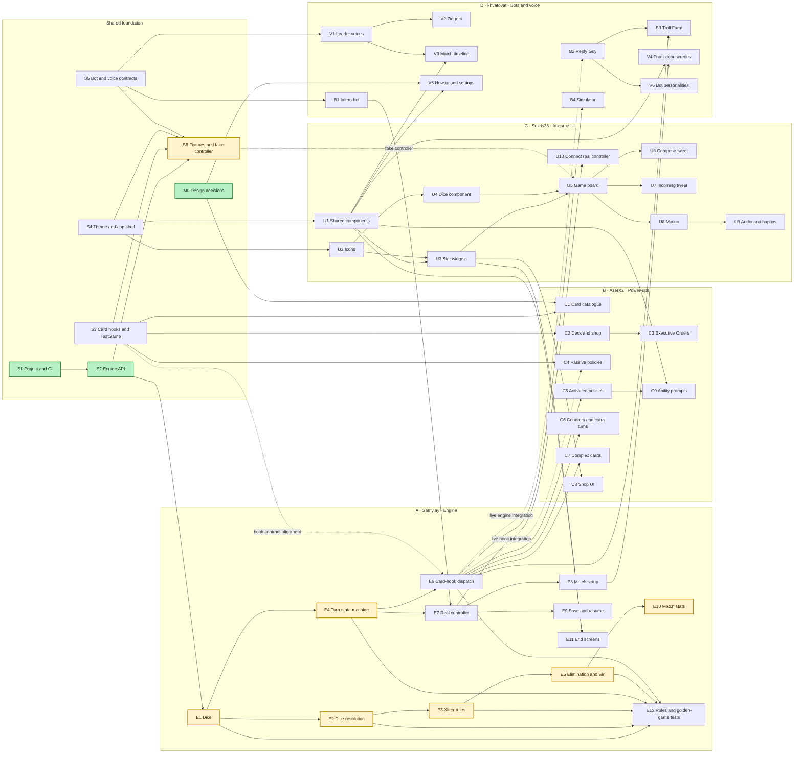

# Project dependency graph

This graph combines the task dependencies and cross-team hand-offs from
[`ROADMAP.md`](../ROADMAP.md) and [`docs/team/`](team/). Green means the task's
implementation is verified, committed, and pushed, including applicable
requirements in ROADMAP §7. Yellow means implementation or verification is in
progress. Green does not imply that a PR has been reviewed or merged.

## Current hand-offs

- E6 needs S3's `CardEffect` hook contract. It unlocks C5–C7, B3, and B4.
- Align AzerX2's S3 hook list with the already-committed S2 engine API before
  E6 is implemented.
- E7 needs B1. Until then, use the always-first-option bot described in the
  Samylay guide.
- U1–U3 support end-game, shop, and front-door screens. Teams can use Material
  stand-ins until those components land.
- S6 is shared: Samylay supplies fixture states and Seleis36 checks them against
  the design screens.
- M0 design decisions are settled in ROADMAP §1. AzerX2 owns updating the
  Bot Farm catalogue/design to the agreed 40-character cost.
